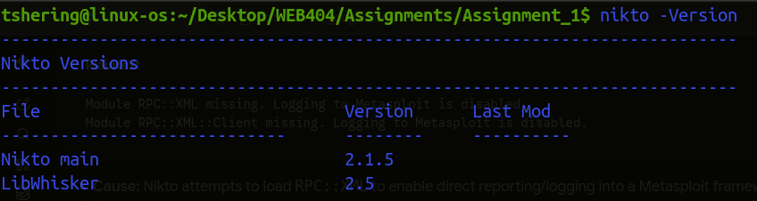
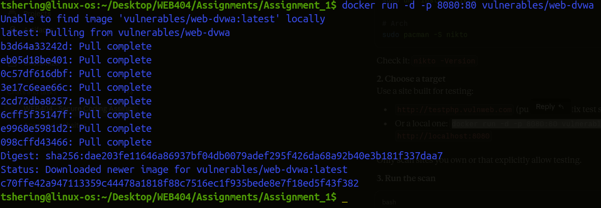
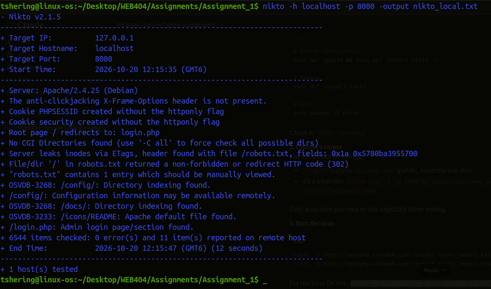
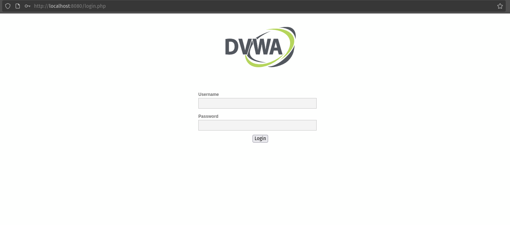

# Assignment 1: Vulnerability Assessment of a Sample Website Using Nikto

**Student:** Tshering Phuntsho  
**Student ID:** 02230310  
**Module:** WEB404 - Secure Coding Practices     
**Date:** 18 August, 2026  

## 1. Objective

To conduct a vulnerability assessment of a sample website using the Nikto web server scanner, interpret the findings, rate their risk, and recommend mitigations.

## 2. Tools and Environment

| Item | Details |
|---|---|
| Operating system | Linux |
| Scanner | Nikto v2.1.5 |
| Target | Damn Vulnerable Web Application (DVWA), running locally in Docker |
| Target address | `http://localhost:8080` |
| Web server | Apache with PHP |

DVWA is an intentionally vulnerable application built for security training. Scanning a self-hosted instance ensures the assessment is legal and authorised.

## 3. Methodology

Nikto is an open-source scanner that checks web servers for dangerous files, outdated software, insecure configurations and missing security headers. It performs a non-intrusive, signature-based scan.

Steps followed:

1. Installed Nikto and started the DVWA container.
```bash
sudo apt update && sudo apt install nikto -y
```
Check it: `nikto -Version`





2. Ran the scan against the local target and saved the output:

```bash
nikto -h localhost -p 8080 -output nikto_local.txt
```


3. Reviewed the output, grouped findings by category, rated each by risk, and proposed fixes.



This is the sample website that I did the vulnerability assessment.

## 4. Scan Results (Raw Output)

```text
- Nikto v2.1.5/2.1.5
+ Target Host: localhost
+ Target Port: 8080
+ GET /: The anti-clickjacking X-Frame-Options header is not present.
+ GET /: Cookie PHPSESSID created without the httponly flag
+ GET /: Cookie security created without the httponly flag
+ GET /robots.txt: Server leaks inodes via ETags, header found with file /robots.txt
+ GET //: File/dir '/' in robots.txt returned a non-forbidden or redirect HTTP code (302)
+ GET /robots.txt: "robots.txt" contains 1 entry which should be manually viewed.
+ -3268: GET /config/: /config/: Directory indexing found.
+ GET /config/: /config/: Configuration information may be available remotely.
+ -3268: GET /docs/: /docs/: Directory indexing found.
+ -3233: GET /icons/README: /icons/README: Apache default file found.
+ GET /login.php: /login.php: Admin login page/section found.
```
This output is also saved in the nikto_local.txt file.

## 5. Findings and Interpretation

The scan reported eleven lines, which group into eight distinct findings.

| # | Finding | Category | Risk |
|---|---|---|---|
| 1 | Directory indexing on `/config/` and configuration information may be available | Information disclosure / exposed files | **High** |
| 2 | Directory indexing on `/docs/` | Information disclosure | Medium |
| 3 | `PHPSESSID` and `security` cookies set without the `HttpOnly` flag | Cookie security | Medium |
| 4 | `X-Frame-Options` header missing | Missing security header | Medium |
| 5 | Admin login page found at `/login.php` | Attack surface | Low |
| 6 | `robots.txt` contains an entry to review; `/` returns a 302 redirect | Information disclosure | Low |
| 7 | ETag leaks file inode numbers (`/robots.txt`) | Information disclosure (CVE-2003-1418) | Low |
| 8 | Apache default file `/icons/README` present | Default content | Low |

### 5.1 Directory indexing on `/config/` (High)

When directory listing is enabled, anyone can browse the folder contents. Nikto also flagged that configuration information may be retrievable. Configuration files commonly hold database credentials, API keys and application secrets, so exposure could lead to full compromise of the database and application.

### 5.2 Directory indexing on `/docs/` (Medium)

A browsable `/docs/` folder reveals the file structure, documentation and sometimes version details, which helps an attacker plan targeted attacks.

### 5.3 Cookies without HttpOnly (Medium)

Both `PHPSESSID` (session identifier) and `security` can be read by client-side JavaScript. If the site has a cross-site scripting (XSS) flaw, an attacker can steal the session cookie and hijack the user's session.

### 5.4 Missing X-Frame-Options (Medium)

Without this header, the site can be loaded inside a hidden iframe on a malicious page. Users can then be tricked into clicking elements they cannot see (clickjacking).

### 5.5 Admin login page exposed (Low)

A publicly known login URL is a target for brute-force and credential-stuffing attacks. It is expected for a login page to exist, so the risk is low if protective controls are in place.

### 5.6 robots.txt entry and redirect (Low)

`robots.txt` is meant for search engines but is publicly readable. Listing sensitive paths in it advertises them to attackers instead of hiding them.

### 5.7 ETag inode leakage (Low)

Apache's default ETag format includes the file's inode number, which discloses file system details and, in older setups, could support attacks such as NFS file handle guessing.

### 5.8 Apache default file (Low)

The presence of `/icons/README` confirms the server software and indicates default content was not removed, which helps attackers fingerprint the server.

## 6. Risk Summary

| Risk level | Count | Findings |
|---|---|---|
| High | 1 | Exposed `/config/` |
| Medium | 3 | `/docs/` listing, HttpOnly cookies, missing X-Frame-Options |
| Low | 4 | Login page, robots.txt, ETag leak, default file |

The most serious weakness is the exposed configuration directory because it may directly leak credentials. The remaining issues are hardening gaps that weaken the overall security posture and make other attacks more effective.

## 7. Recommended Mitigations

| Finding | Mitigation |
|---|---|
| Directory indexing | Disable with `Options -Indexes`; deny web access to `/config/`; keep config files outside the web root |
| HttpOnly cookies | Set `session.cookie_httponly = 1` in `php.ini`; also enable `Secure` and `SameSite` |
| Missing X-Frame-Options | Add `X-Frame-Options: SAMEORIGIN` or CSP `frame-ancestors 'self'` |
| Admin login page | Add rate limiting, account lockout, multi-factor authentication and optional IP restriction |
| robots.txt | Do not list sensitive paths; protect them with authentication |
| ETag leak | Set `FileETag MTime Size` |
| Default files | Remove the default icons, manual and README content |

Sample Apache configuration:

```apache
Options -Indexes
FileETag MTime Size
Header always set X-Frame-Options "SAMEORIGIN"
Header always set X-Content-Type-Options "nosniff"

<Directory /var/www/html/config>
    Require all denied
</Directory>
```

Sample PHP configuration:

```ini
session.cookie_httponly = 1
session.cookie_secure = 1
session.cookie_samesite = Strict
```

## 8. Limitations

- Nikto v2.1.5 is an older release, so it checks fewer modern security headers (such as Content-Security-Policy and Strict-Transport-Security) than current versions.
- Nikto is signature-based and noisy. It does not exploit vulnerabilities, so findings need manual verification.
- The target is intentionally vulnerable, so these results are expected and do not represent a production system.

## 9. Conclusion

The Nikto scan of the DVWA instance revealed exposed directories, insecure cookie settings, a missing anti-clickjacking header, and leftover default content. The highest-risk issue is the browsable `/config/` directory, which could expose sensitive configuration data. Applying the recommended fixes (disabling directory indexing, restricting sensitive folders, setting cookie flags, adding security headers and removing default files) would significantly reduce the attack surface. The assessment shows how an automated scanner can quickly highlight common misconfigurations, though its results should always be validated manually and complemented with other testing.

## 10. References

- Nikto project: cirt.net/Nikto2 and github.com/sullo/nikto
- OWASP Web Security Testing Guide
- OWASP Secure Headers Project
- DVWA: github.com/digininja/DVWA