# Assignment 2: Secure File Upload Feature and Prevention of Malicious Uploads

**Student:** Tshering Phuntsho  
**Student ID:** 02230310  
**Module:** WEB404 - Secure Coding Practices     
**Date:** 2 September, 2026  

## 1. Objective

To develop a file upload feature, demonstrate how an unprotected implementation can be abused by malicious uploads, and implement layered security measures that prevent them.

## 2. Introduction

File upload functionality is a common attack vector. If an application accepts files without validation, an attacker can upload a web shell, a script that runs in the victim's browser (stored XSS), an oversized file that exhausts disk space, or a file that overwrites existing data. Common consequences include remote code execution, defacement, data theft and denial of service. (OWASP lists unrestricted file upload as a well-known web application vulnerability.)

## 3. Tools and Environment

| Item | Details |
| --- | --- |
| Operating system | Linux |
| Runtime | Node.js |
| Framework | Express 4 |
| Upload handling | Multer |
| Content inspection | file-type (magic-byte detection) |
| Testing tools | curl, web browser |

Two versions of the same application were built:

- **Vulnerable version** (`vulnerable.js`, port 3000): no validation.
- **Secure version** (`secure.js`, port 3001): layered security controls.

*Commands: `ls -R upload-lab | head -20` and `npm install`.*  
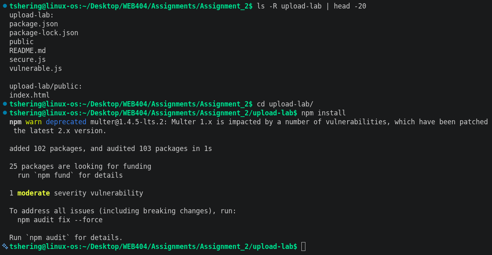
*Screenshot 1: Project folder and dependency installation.*

## 4. System Design

Both versions expose the same HTML form (`public/index.html`) that posts a single file to `/upload`.

| Aspect | Vulnerable version | Secure version |
| --- | --- | --- |
| Port | 3000 | 3001 |
| Storage location | `public/uploads` (inside web root) | `private_uploads` (outside web root) |
| Filename | Original name from user | Random UUID generated by server |
| Type validation | None | Extension allowlist, MIME check, magic-byte check |
| Size limit | None | 2 MB |
| File count limit | None | 1 per request |
| File serving | Directly by static file server | Controlled download route with safe headers |

## 5. Vulnerable Implementation

The vulnerable version uses Multer's disk storage with the original filename and no filter or limits. Uploaded files are saved in a folder that the web server serves directly.

```javascript
const upload = multer({
  storage: multer.diskStorage({
    destination: dir,
    filename: (req, file, cb) => cb(null, file.originalname),
  }),
});
app.use(express.static(path.join(__dirname, 'public')));
```

**Weaknesses:** any file type accepted, user-controlled filename, no size limit, and stored inside the web root.

*Command: `node vulnerable.js` showing the startup message.*

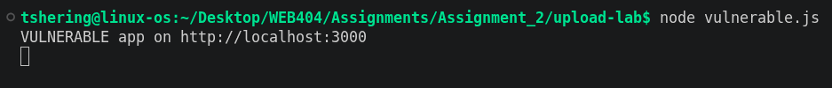
*Screenshot 2: Vulnerable app running.*

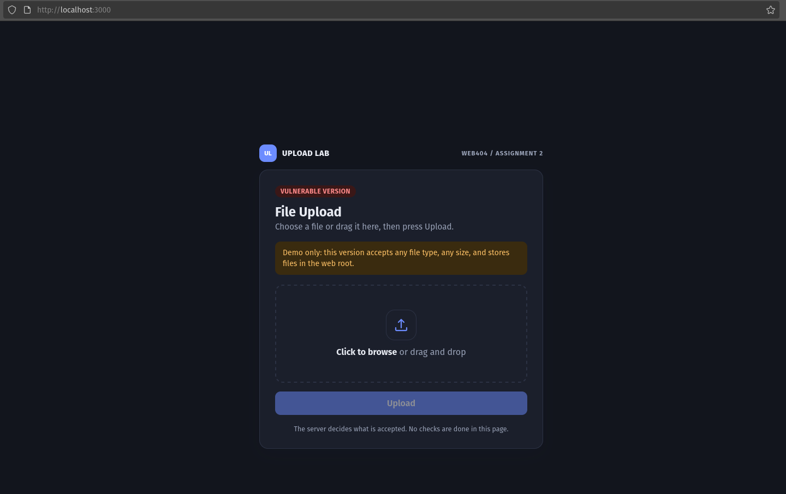
*Screenshot 3: Vulnerable upload form in the browser at `http://localhost:3000`*

## 6. Attack Demonstration on the Vulnerable Version

### 6.1 Test files

```bash
mkdir test_files && cd test_files
echo '<?php system($_GET["c"]); ?>' > shell.php
cp shell.php fake.jpg
cp shell.php shell.php.jpg
echo '<script>alert(1)</script>' > xss.html
head -c 3000000 /dev/zero > big.png
```
Command: `ls -l` inside the `test_files` folder

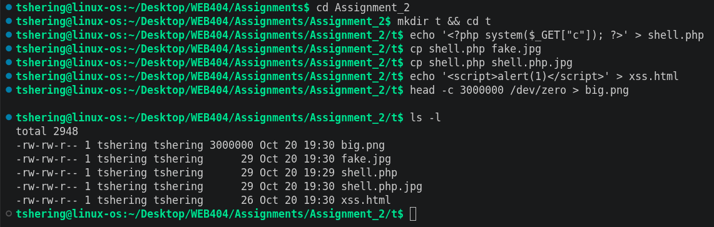
*Screenshot 4: Test files created.*

### 6.2 Attack 1: Web shell upload


*Screenshot 5: Upload response and the retrieved file.*

**Result:** the server accepted the `.php` file and made it publicly retrievable from the web root. Express only serves the file as static content, so the code is returned as text here. On a server that executes PHP (for example Apache with PHP), the same file would run and give the attacker remote command execution.

### 6.3 Attack 2: Stored XSS via HTML upload


*Screenshot 6: Upload response.*

Then open `http://localhost:3000/uploads/xss.html` in the browser. The script executes in the application's origin, so it could steal cookies or act as the victim.

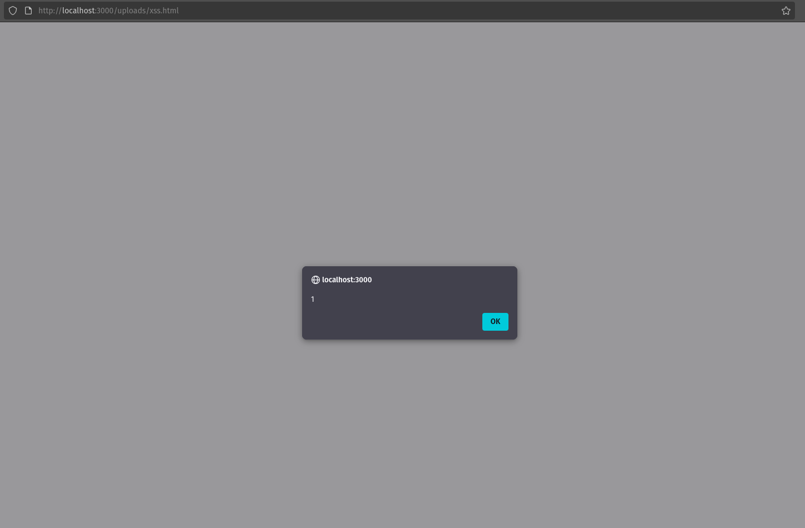
*Screenshot 7: Browser showing the JavaScript alert from `xss.html`.*

### 6.4 Attack 3: File size, Double extention and Fake file upload

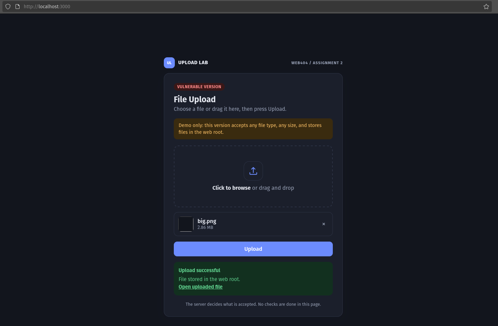
*Screenshot 8: Big file size upload response*

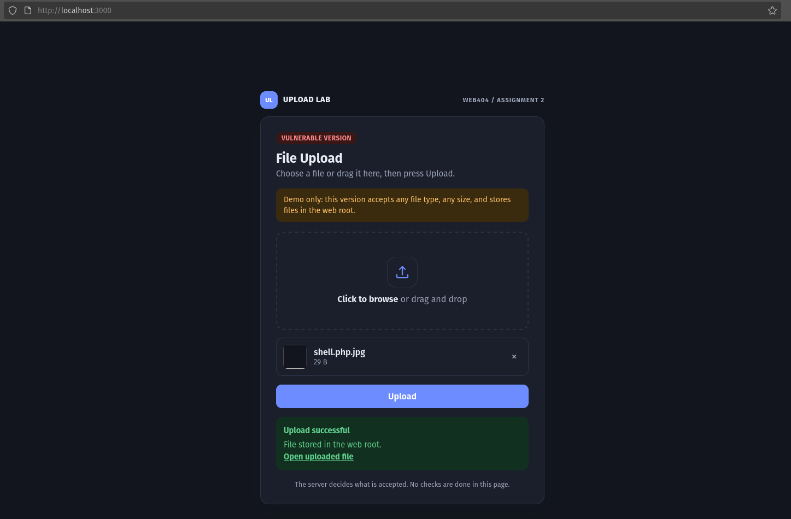
*Screenshot 9: Double Extention file upload response*

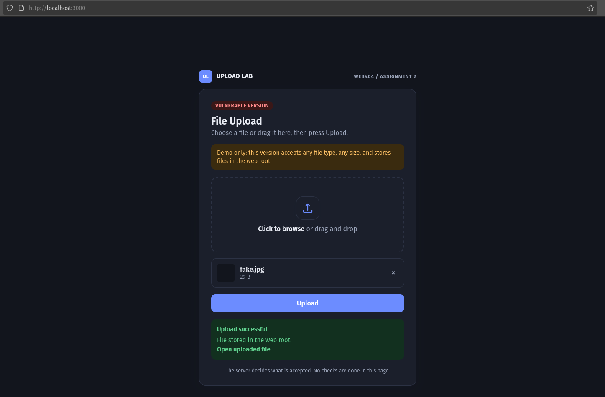
*Screenshot 10: Fake file upload response*

### 6.5 Summary of vulnerable behaviour

| Attack | Accepted? | Impact |
| --- | --- | --- |
| `shell.php` | Yes | Web shell stored in web root |
| `xss.html` | Yes | Stored XSS |
| Any size or type | Yes | Storage exhaustion, malware hosting |
| Original filename kept | Yes | Overwrite of existing files, path abuse |
| fake.png | Yes | Disguised malicious content and malware hosting |

## 7. Security Measures Implemented

| # | Control | Threat addressed |
| --- | --- | --- |
| 1 | Extension allowlist (`.jpg`, `.jpeg`, `.png`, `.pdf`) | Executable scripts such as `.php`, `.html`, `.js` |
| 2 | Double-extension rejection | Bypass with names like `shell.php.jpg` |
| 3 | Client MIME type must match the extension | Obvious type mismatches |
| 4 | Magic-byte (content) verification with `file-type` | Malicious files renamed to look like images |
| 5 | 2 MB size limit and one file per request | Denial of service, disk exhaustion |
| 6 | Random UUID filename, extension taken from the detected type | Path traversal, overwrite, user-controlled names |
| 7 | Storage outside the web root, files never executed | Direct execution or browsing of uploads |
| 8 | Controlled download route with ID pattern check | Path traversal on download |
| 9 | `Content-Disposition: attachment`, `X-Content-Type-Options: nosniff`, `Content-Security-Policy: default-src 'none'` | Browser rendering or script execution of uploaded content |
| 10 | Memory storage until validated | Nothing written to disk before it passes all checks |

Key code from `secure.js`:

```javascript
const ALLOWED = { '.jpg': 'image/jpeg', '.jpeg': 'image/jpeg',
                  '.png': 'image/png', '.pdf': 'application/pdf' };

const upload = multer({
  storage: multer.memoryStorage(),
  limits: { fileSize: 2 * 1024 * 1024, files: 1 },
  fileFilter: (req, file, cb) => {
    const name = path.basename(file.originalname).toLowerCase();
    const ext = path.extname(name);
    if (!ALLOWED[ext]) return cb(new Error('Extension not allowed'));
    if (name.split('.').length > 2) return cb(new Error('Multiple extensions not allowed'));
    if (file.mimetype !== ALLOWED[ext]) return cb(new Error('MIME type mismatch'));
    cb(null, true);
  },
});

// after upload: verify real content
const detected = await FileType.fromBuffer(req.file.buffer);
if (!detected || detected.mime !== ALLOWED[ext]) { /* reject */ }

// store with a random name outside the web root
const id = crypto.randomUUID() + '.' + detected.ext;
```

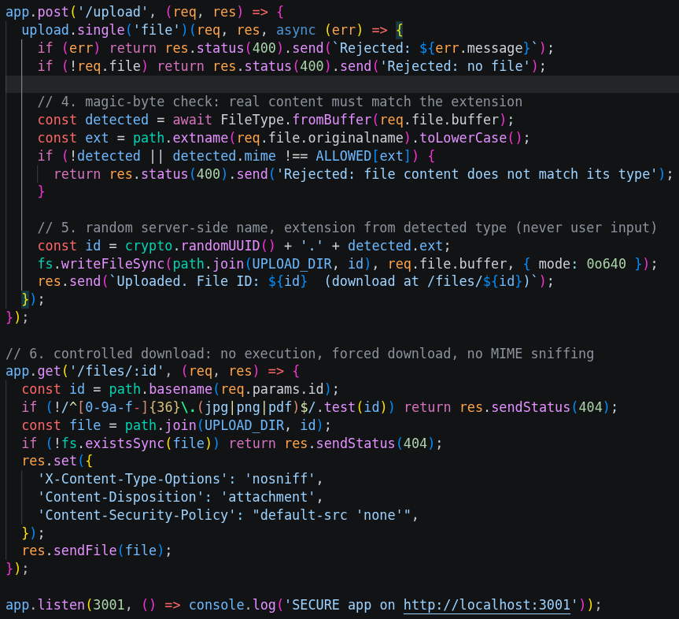  
*Screenshot 11: Code of the secure implementation.*

## 8. Testing the Secure Version

Start the secure server:

```bash
node secure.js
```
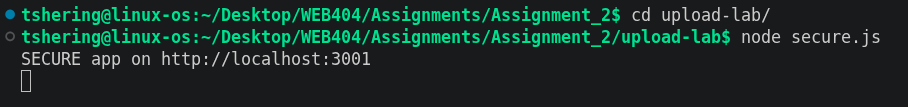  
*Screenshot 12: Secure app running.*

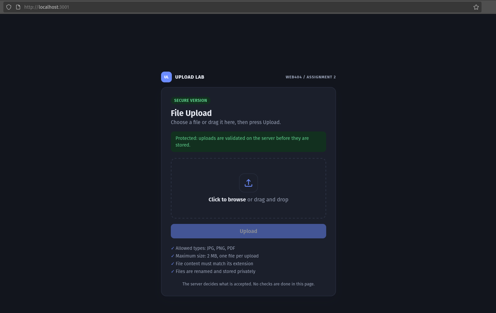
*Screenshot 13: Secure upload form in the browser at `http://localhost:3001`*

### 8.1 Malicious upload attempts

**All five rejected uploads**


*Screenshot 14: Shell.php file upload rejected.*


*Screenshot 15: fake.jpg file upload rejected.*

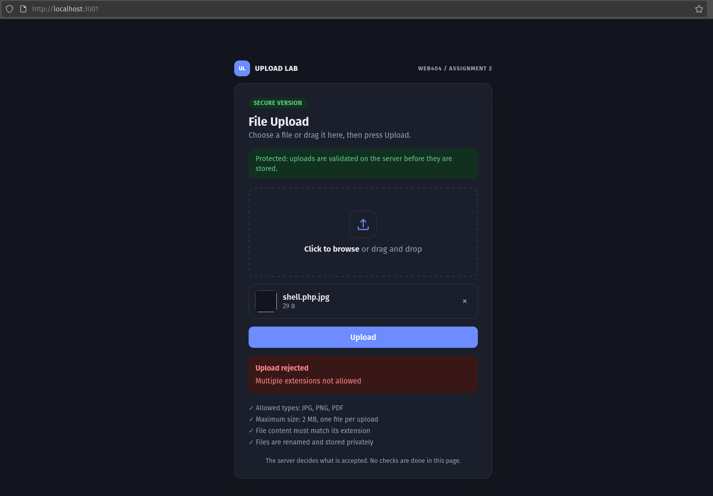
*Screenshot 16: Shell.php.jpg file upload rejected.*


*Screenshot 17: xss.html file upload rejected.*


*Screenshot 18: big.png file upload rejected.*

### 8.2 Legitimate upload and download

The valid file was accepted, stored under a random UUID name, and returned with the headers `X-Content-Type-Options: nosniff`, `Content-Disposition: attachment` and `Content-Security-Policy: default-src 'none'`.

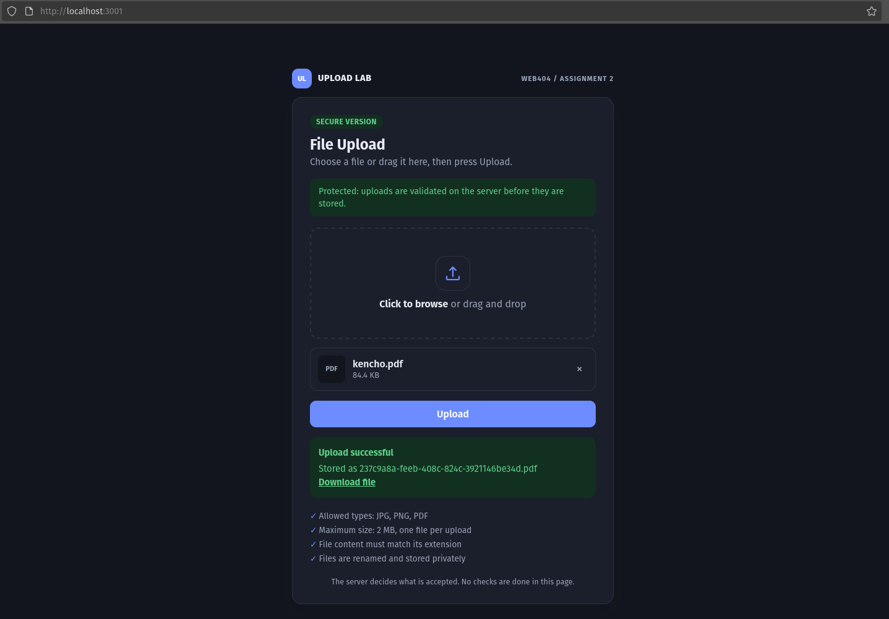
*Screenshot 19: Successful upload response.*

### 8.3 Path traversal and storage check

```bash
curl -s -o /dev/null -w "%{http_code}\n" "localhost:3001/files/..%2fsecure.js"
ls private_uploads
```

The traversal attempt returned HTTP 404, and the stored file has a random UUID name in a folder outside the web root.

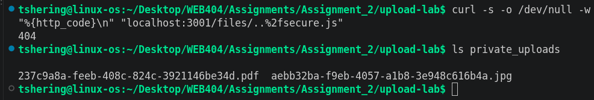
*Screenshot 20: 404 result and the `private_uploads` directory listing.*

### 8.4 Results

| Test file | Vulnerable app (3000) | Secure app (3001) | Control that stopped it |
| --- | --- | --- | --- |
| `shell.php` | Accepted | Rejected: Extension not allowed | Extension allowlist |
| `fake.jpg` (PHP code named as image) | Accepted | Rejected: content does not match type | Magic-byte check |
| `shell.php.jpg` | Accepted | Rejected: Multiple extensions not allowed | Double-extension check |
| `xss.html` | Accepted | Rejected: Extension not allowed | Extension allowlist |
| `big.png` (3 MB) | Accepted | Rejected: File too large | Size limit |
| `kencho.pdf` (valid file) | Accepted | Accepted, stored with UUID name | Passes all checks |
| `../` traversal on download | Not applicable | 404 | ID pattern validation |

## 9. Analysis

No single check is enough. The extension check alone is bypassed by renaming, and the MIME type sent by the client can be forged, so the server also inspects the file's real content. Storing files outside the web root with random names and serving them as downloads with `nosniff` and a restrictive CSP means that even if a malicious file slipped through, it could not be executed or rendered by the browser. Using an allowlist instead of a blocklist is important because blocklists miss unexpected dangerous types.

## 10. Limitations and Further Improvements

- No antivirus or malware scanning of uploaded files (for example ClamAV integration).
- Images are not re-encoded. Re-processing images (for example with `sharp`) strips embedded payloads and metadata.
- No authentication, rate limiting or per-user quotas.
- SVG files are intentionally excluded because they can contain scripts.
- Production systems should store uploads in object storage (for example S3) on a separate domain, with private access and signed URLs.
- Run the application as a low-privilege user and keep the upload folder non-executable.

## 11. Conclusion

The unprotected application accepted every file, including a PHP web shell and an HTML file with JavaScript and exposed them from the web root. The secure version blocked all of these malicious uploads through layered controls: extension allowlist, double-extension check, MIME and magic-byte validation, size limits, random filenames, storage outside the web root and safe download headers. The experiment shows that secure file upload relies on defence in depth, validating on the server and never trusting user-supplied names, types or content.

## 12. References

- OWASP: Unrestricted File Upload
- OWASP File Upload Cheat Sheet
- OWASP Web Security Testing Guide, Testing for Unrestricted File Upload
- Multer and file-type package documentation
