# Assignment: CSRF Vulnerable Form and CSRF Token Protection

**Student:** Tshering Phuntsho  
**Student ID:** 02230310  
**Module:** WEB404 - Secure Coding Practices     
**Date:** 24 September, 2026  

## 1. Objective

To build a web form vulnerable to Cross-Site Request Forgery (CSRF), demonstrate an attack against it, then implement CSRF tokens and show that the same attack is blocked.

## 2. Introduction

CSRF tricks a logged-in user's browser into sending a state-changing request to a site without the user intending it. The browser automatically attaches the user's cookies to the request, so if the target site only checks for a valid session cookie, it cannot tell a genuine request from one triggered by a malicious page the user merely visited. Typical impacts include changing account details, transferring funds, or changing a password.

## 3. Tools and Environment

| Item | Details |
| --- | --- |
| Operating system | Linux |
| Runtime | Node.js |
| Framework | Express 4 |
| Testing tools | Browser, curl |

Two versions of a simple "Account Settings" app were built, both letting a user change their email address:

- **Vulnerable version** (`vulnerable.js`, port 4000): no CSRF protection.
- **Secure version** (`secure.js`, port 4001): synchronizer CSRF token plus a `SameSite` cookie.
- An **attacker page** (`attacker/evil.html`) simulates a malicious site that forges the request.

**Command:** `cd csrf-lab` then `ls`

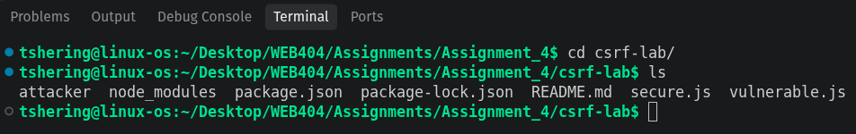
*Screenshot 1: Project files.*

## 4. Vulnerable Implementation

The vulnerable app's form posts directly to `/change-email` with no token, and the server accepts any request that includes the `email` field, regardless of where it came from.

```javascript
app.get('/', (req, res) => {
  res.send(`
    <form method="POST" action="/change-email">
      <input name="email" value="${userEmail}">
      <button type="submit">Update Email</button>
    </form>`);
});

app.post('/change-email', (req, res) => {
  userEmail = req.body.email;   // no CSRF check
  res.send(`Email changed to: ${userEmail}`);
});
```
**Command:** `node vulnerable.js`, then open `http://localhost:4000`

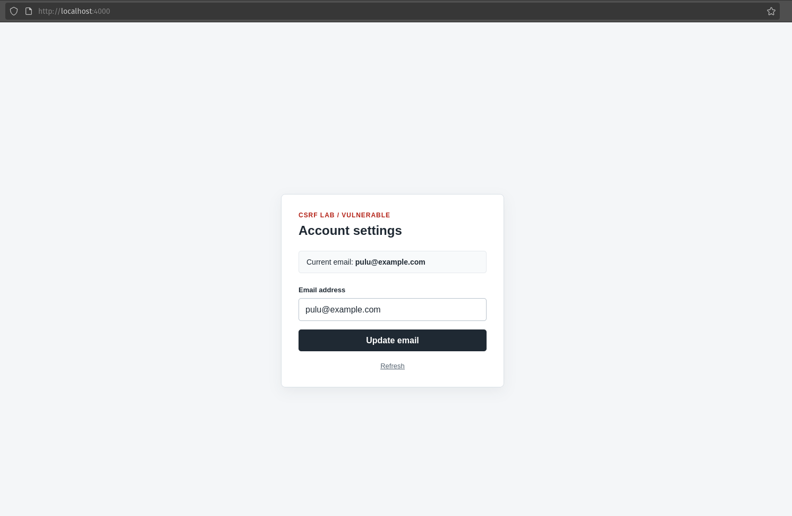
*Screenshot 2: Vulnerable app running and the account settings page in the browser.*

By default the current email is pulu@example.com

## 5. Attack Demonstration

### 5.1 Attacker page

`attacker/evil.html` contains a hidden form that targets the vulnerable app and submits itself automatically when the page loads:

```html
<body onload="document.forms[0].submit()">
  <form action="http://localhost:4000/change-email" method="POST">
    <input type="hidden" name="email" value="attacker@evil.com">
  </form>
</body>
```

In a real attack, this page would be hosted on a different domain and the victim would be lured to it (for example through a phishing link or a malicious ads). The browser does not need to ask permission to submit a form cross-site and it still attaches any cookies the victim holds for `localhost:4000`.

### 5.2 Steps

1. Start the vulnerable app and open `http://localhost:4000` in the browser to establish a session.
2. Without logging out, open `attacker/evil.html` in the same browser (simulating a visit to a malicious page).
3. The hidden form submits automatically.
4. Reload `http://localhost:4000`.


*Screenshot 3: The account page before the attack, showing the original email.*

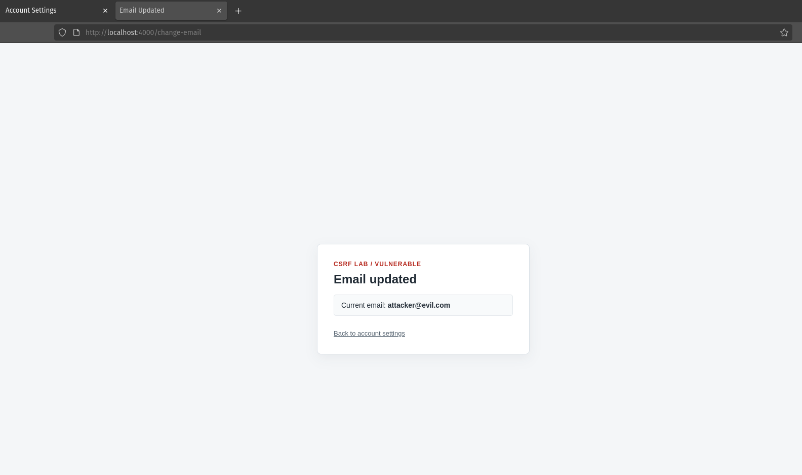
*Screenshot 4: `attacker/evil.html` open in the browser (it looks like an ordinary page).*

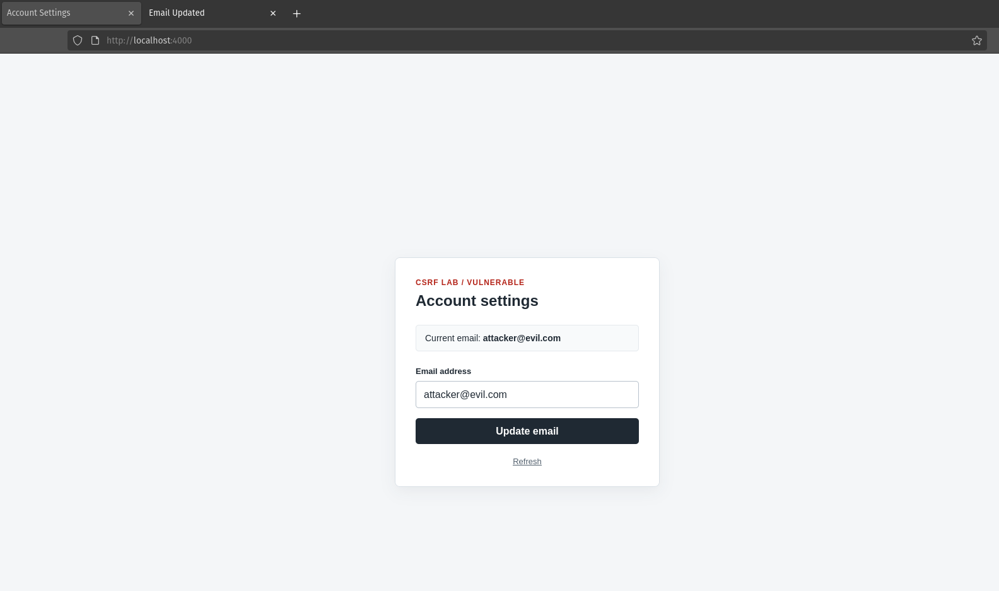
*Screenshot 5: The account page after the attack, showing the email changed to `attacker@evil.com` without the user filling in the form.*

### 5.3 Equivalent command-line test

To confirm the server itself has no CSRF defence (independent of the browser demo):

```bash
curl -s -X POST localhost:4000/change-email -d "email=attacker@evil2.com"

curl -s localhost:4000/ | grep -o 'Current email: <b>[^<]*'
```

**Result:** the POST succeeds with no token, no referer check and no proof the request came from the real form.

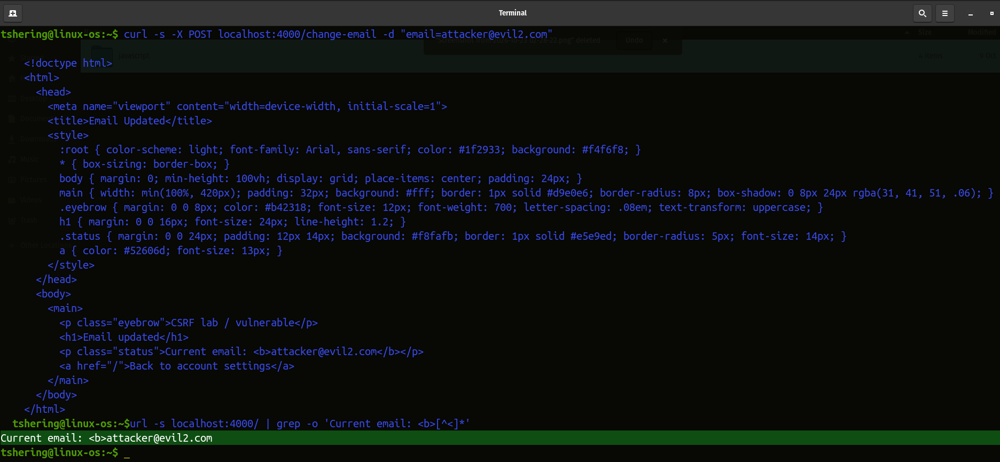
*Screenshot 6: Terminal output of the two commands above, showing the email changed.*

## 6. Security Measure Implemented: CSRF Tokens

The secure version uses the **synchronizer token pattern**:

1. On each page load, the server generates (or reuses) a random, unpredictable token tied to the user's session and stores it server-side.
2. The token is embedded in the form as a hidden field.
3. On submission, the server compares the submitted token against the one stored for that session, using a constant-time comparison.
4. The request is rejected with HTTP 403 if the token is missing, wrong, or does not match the session.
5. The session cookie is also set with `SameSite: strict`, which stops browsers from sending it on cross-site requests at all, as a second layer of defence.

```javascript
// token generated per session, stored server-side
sessions[sid] = crypto.randomBytes(32).toString('hex');
res.cookie('session', sid, { httpOnly: true, sameSite: 'strict' });

// embedded in the form
'<input type="hidden" name="csrf_token" value="${token}">'  

// verified on submit  
const ok = expected && submitted &&
  crypto.timingSafeEqual(Buffer.from(expected), Buffer.from(submitted.padEnd(expected.length)));
if (!ok || submitted.length !== expected.length) {
  return res.status(403).send('Request blocked: missing or invalid CSRF token.');
}
```

## 7. Testing the Secure Version

```bash
node secure.js
```
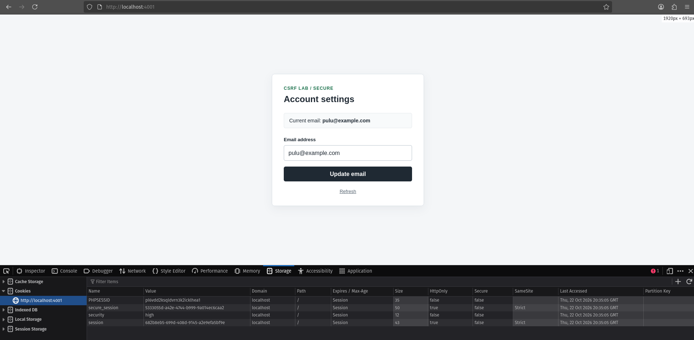
*Screenshot 7: Secure app running and the account page, with the hidden token field visible via "View Page Source".*

### 7.1 Forged request with no token

```bash
curl -s -X POST localhost:4001/change-email -d "email=attacker@evil.com"
```

**Result:** `403 Forbidden — Request blocked: missing or invalid CSRF token.`

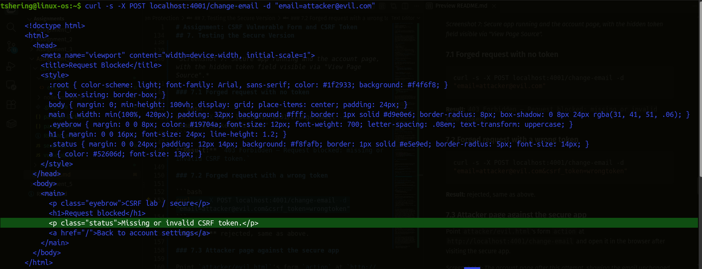
*Screenshot 8: email update request on secure form got blocked.*

### 7.2 Forged request with a wrong token

```bash
curl -s -X POST localhost:4001/change-email -d "email=attacker@evil.com&csrf_token=wrongtoken"
```

**Result:** rejected, same as above.

Giving wrong token also got blocked.

### 7.3 Attacker page against the secure app

Point `attacker/evil.html`'s form `action` at `http://localhost:4001/change-email` and open it in the browser after visiting the secure app.

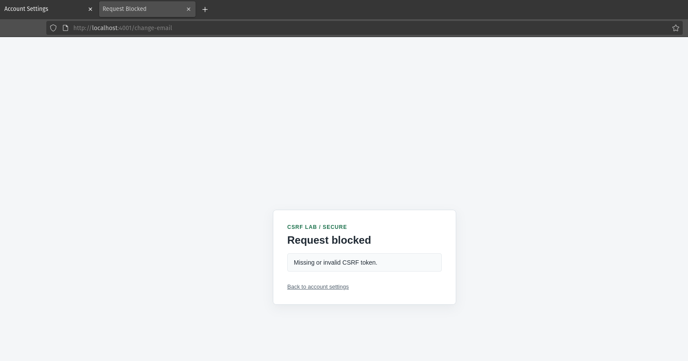
*Screenshot 9: CSRF attacked blocked, showing missing or invalid token*

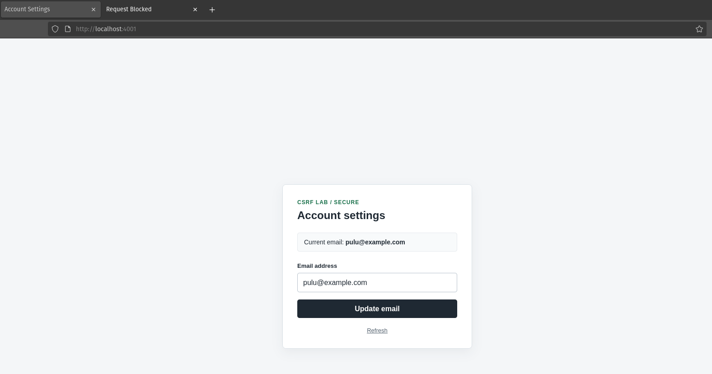
*Screenshot 10: The account page after this attempt, showing the email unchanged.*

### 7.4 Legitimate request with the correct token

```bash
curl -s -X POST http://localhost:4001/change-email \
  -b "session=session-id" \
  -d "email=legit@example.com&csrf_token=correct-token"
```

**Result:** succeeds, since the token matches the session that issued it.

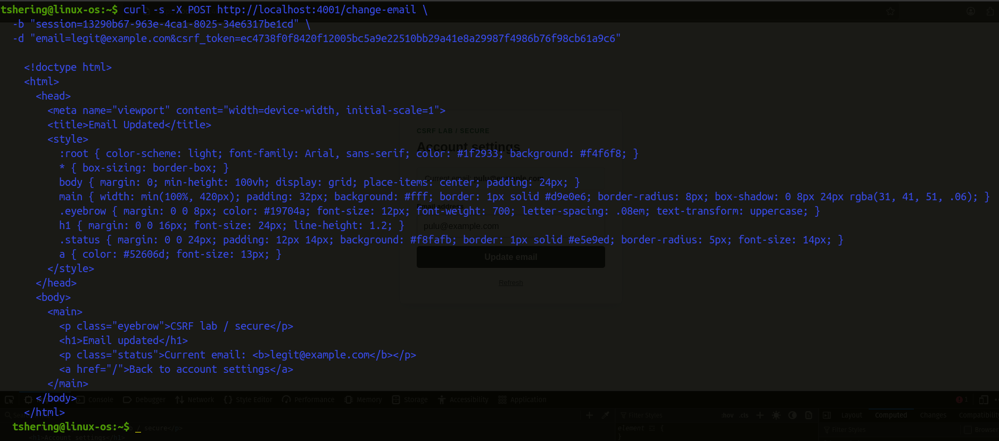
*Screenshot 11: Terminal output showing accepted requests.*

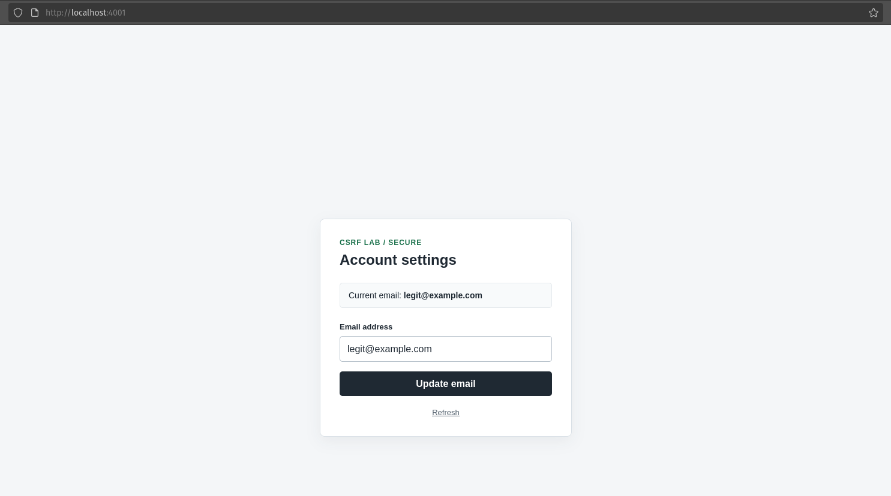
*Screenshot 12: Email updated in the account setting form.*

## 8. Results Summary

| Test | Vulnerable app (4000) | Secure app (4001) |
| --- | --- | --- |
| Attacker page auto-submit | Email changed without user action | Blocked / email unchanged |
| Forged POST, no token | Succeeds | 403 Forbidden |
| Forged POST, wrong token | Succeeds (token not checked) | 403 Forbidden |
| Legitimate form submission | Succeeds | Succeeds (token matches session) |

## 9. Analysis

The vulnerable app trusts any request that carries a valid session cookie, which the browser attaches automatically and which the attacker's page never needs to see or know. The CSRF token breaks this because it is a secret value the attacker's page cannot read or guess: it is not stored in a cookie (so it is not sent automatically) and the attacker page has no way to fetch it, since it lives on a different origin from the vulnerable page and the browser's same-origin policy blocks that page from reading the real form's contents. Adding `SameSite: strict` is a complementary, defence-in-depth control: even if a token were somehow leaked, the browser would withhold the session cookie itself on cross-site requests.

## 10. Limitations and Further Improvements

- This demo uses a single global token per session for simplicity; production systems often use per-request or per-form tokens for extra safety.
- `SameSite: strict` can block legitimate cross-site navigation flows (for example links from emails); `SameSite: lax` is a common middle ground.
- For APIs consumed by JavaScript (not HTML forms), a double-submit cookie pattern or a custom request header (checked server-side) is a common alternative to synchronizer tokens.
- GET requests should never perform state-changing actions, since they are trivially triggered by `` tags or links and cannot carry a hidden form token this way.
- Modern frameworks (Express with `csurf`/`csrf-csrf`, Django, Rails, Spring) provide built-in CSRF middleware; using a well-tested library is preferable to custom implementations in real applications.

## 11. Conclusion

The vulnerable application allowed an attacker page to silently change a logged-in user's email, because it relied solely on the session cookie that the browser sends automatically. Implementing a per-session CSRF token, checked on every state-changing request, combined with a `SameSite` cookie, blocked the forged request while still allowing the legitimate form to work. This demonstrates why state-changing actions must verify that the request was intentionally made by the user, not merely that the user has a valid session.

## 12. References

- OWASP: Cross-Site Request Forgery (CSRF)
- OWASP CSRF Prevention Cheat Sheet
- MDN Web Docs: SameSite cookies
